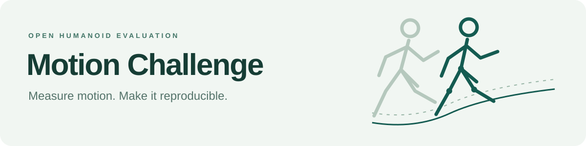

  <a href="https://motion-challenge-project.github.io/motion-challenge-project/leaderboard/">🏆 <b>Leaderboard</b></a> &nbsp; · &nbsp;
  <a href="https://github.com/motion-challenge-project/motion-challenge">⚙️ <b>Evaluation core</b></a> &nbsp; · &nbsp;
  <a href="https://motion-challenge-project.github.io/motion-challenge-project/models/">🤖 <b>Models</b></a>

Open benchmarks for motion controllers. 📏 Shared rules &nbsp; · &nbsp; 🔍 Public code &nbsp; · &nbsp; 🔁 Reproducible evaluation

Compare success, completion and tracking accuracy. Bring a checkpoint. Keep its native inference. <a href="https://motion-challenge-project.github.io/motion-challenge-project/submit/">Join the benchmark →</a>

